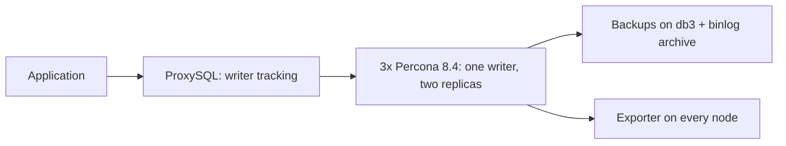

# Percona 8.4 Group Replication on Ubuntu

Ansible automation that deploys a production-style MySQL high-availability
stack: three Percona Server 8.4 nodes in single-primary Group Replication,
fronted by ProxySQL, with XtraBackup-based backups and Prometheus exporters
included. Ubuntu 22.04 or 24.04 amd64 throughout.

Start here if you are new to Ansible: read
[the beginner guide](docs/beginner-guide.md) first, then come back to the
four steps below. Everything else in this README points to a longer guide
when you need it.



## Pick a topology

| | One ProxySQL | Two ProxySQL |
|---|---|---|
| Inventory | `inventories/group-one-proxy.yml` | `inventories/group-two-proxies.yml` |
| Playbook | `playbooks/group-one-proxy.yml` | `playbooks/group-two-proxies.yml` |
| Servers | 3 database + 1 proxy | 3 database + 2 proxy |
| Client endpoint | Proxy IP, port 6033 | VIP or load balancer, port 6033 |
| Proxy redundancy | No, single point of failure | Yes, with keepalived VIP |

Both run the same deployment workflow; the inventory selects the topology.
Database failover is automatic in both: if the writer fails, the group elects
a new one and ProxySQL follows it. Use two proxies when a proxy outage must
not stop the application. Use one proxy for a lab, or when a load balancer
already sits in front of the proxies.

## Before you start: checklist

- VMs: 3 database VMs plus 1 or 2 proxy VMs, Ubuntu 22.04 or 24.04 amd64 only.
  Preflight enforces the OS version.
- Database VMs: at least 20 GB free on the datadir filesystem, and at
  least 3584 MiB memory. A 2 vCPU, 8 GB VM is a good starting size.
- Control machine: Ansible Core 2.16 or newer. Target VMs need SSH, sudo
  and package download access. Ansible installs services on your VMs; it
  does not create them.
- Network, open between the right hosts:
  - 3306 and 33061 between database members
  - 6033 from applications to ProxySQL
  - 6032 only on the proxy itself, for ProxySQL admin
  - 9104 from Prometheus to every database node, for exporters
- Decisions to make once, before deploy: one UUID for the group, seven
  vault passwords, and whether you need a VIP. See the pitfalls below.

No TLS for database internals in this setup, by design. Group Replication
TLS and require-secure-transport default to off, for simpler setup and no
TLS overhead. This assumes database nodes, proxies and applications are
inside a private network that only trusted hosts can reach. See
[day-2 configuration](docs/day-2-configuration.md) for the full reasoning.

## Deploy in four steps

Use the same inventory file in every command. The examples below use the
one-proxy inventory; replace it with the two-proxy inventory if you chose
that topology. See [how inventories work](inventories/README.md).

**1. Install dependencies** (once, on the control machine):

```bash
ansible-galaxy collection install -r requirements.yml
```

**2. Describe your servers.** Edit one inventory file and replace the example
IPs with your VM IPs. Then check that Ansible can reach every host:

```bash
ansible -i inventories/group-one-proxy.yml all -m ping
```

Expect `pong` for every host. Fix SSH or IP problems before deploying.

**3. Set secrets and the group ID.** Edit `inventories/group_vars/all/main.yml`
for server settings, and create the encrypted vault file from the example
key list. Generate one UUID for the group and put it in `percona_group_name`:

```bash
ansible-vault create inventories/group_vars/all/vault.yml
python3 -c 'import uuid; print(uuid.uuid4())'   # put this in percona_group_name
```

Keep the same UUID and the same database credentials on every rerun.
Changing the group UUID after deploy is not supported.

**4. Check, deploy, verify** (same inventory every time):

```bash
ansible-playbook -i inventories/group-one-proxy.yml playbooks/operations/preflight.yml --ask-vault-pass
ansible-playbook -i inventories/group-one-proxy.yml playbooks/group-one-proxy.yml --ask-vault-pass
```

After deploy, take the first full backup on db3, then verify. The backup
role installs the daily cron, it does not run the first backup for you:

```bash
sudo /usr/local/bin/percona-backup backup full   # on db3
ansible-playbook -i inventories/group-one-proxy.yml playbooks/operations/verify.yml --ask-vault-pass
```

Verify checks: 3 ONLINE members with 1 PRIMARY, exactly 1 ONLINE writer in
ProxySQL, application login through 6033, a recent complete backup, every
rotated binlog archived, and exporters healthy.

## What you get

- **One writer, always.** Single-primary Group Replication with GTID and row
  binlogs. Writes go to the elected primary; replicas stay read-only.
- **Automatic failover.** The group elects a new writer and ProxySQL moves
  traffic to it. In-flight writes fail fast and the application retries.
  Expect roughly 15-30 seconds of write outage on a hard crash; a graceful
  writer stop is shorter, because the member leaves the group cleanly.
- **Safe reads after failover.** `group_replication_consistency =
  BEFORE_ON_PRIMARY_FAILOVER` prevents stale reads from a freshly elected
  writer.
- **Backups with point-in-time recovery.** Daily full XtraBackup on db3, a
  7-day retention policy that always keeps the newest chain, and binlog
  archiving every 5 minutes for replay to any point in time.
- **Monitoring ready.** `mysqld_exporter` on every database node with alert
  rules for group health; point your Prometheus at port 9104.
- **Guarded operations.** Preflight checks fail fast on wrong OS, duplicate
  server IDs, placeholder secrets and unreachable peers. Every destructive
  step (bootstrap, restore target selection) asserts before acting.

## Day-2: run the role, do not hand-edit

| Task | Command | Restart? |
|---|---|---|
| Change a setting | `playbooks/operations/configure.yml` | No, for max-connections, long-query-time, binlog-expire-logs-seconds. Yes, rolling, for everything else. |
| Add, change or remove a database or user | `playbooks/operations/access.yml` | No |
| Add, change or remove a ProxySQL user, backend or variable | `playbooks/operations/proxysql.yml` | No, except a listener address change, which restarts ProxySQL |
| Health check any time | `playbooks/operations/verify.yml` | No |
| Backup or restore | `playbooks/operations/backup.yml`, `playbooks/operations/restore.yml` | No, restore runs on a separate standalone VM |

Full detail, with examples, is in
[day-2 configuration](docs/day-2-configuration.md) and
[configuration reference](docs/configuration-reference.md).

Two user lists, one account in only one of them. This is the most common
source of confusion, so read it once and it is clear:

- App connects through ProxySQL (normal case): use `proxysql_users` in
  `inventories/group_vars/proxies.yml` and run `proxysql.yml`. That role
  creates both the MySQL account and the ProxySQL credential.
- Account connects directly to MySQL, not through ProxySQL: use
  `percona_users` in `inventories/group_vars/all/main.yml` and run
  `access.yml`. That role creates only the MySQL account.
- Role defaults with `[]` and commented examples are just the format, not
  active users. Group_vars override them, and group_vars win.

## Common pitfalls, before you hit them

- Replication password: at most 32 characters. Longer passwords fail Group
  Replication with MySQL error 3056. Preflight now checks this for you.
- Group UUID: generate one per deployment, never reuse the example, never
  change it after deploy.
- Disk: preflight needs at least 20 GB free on the datadir filesystem.
- Ubuntu: 22.04 or 24.04 only. A 26.04 VM will fail preflight on purpose.
- First backup: manual, on db3, after deploy. Verify will fail until it exists.
- Inventory default trap: a plain configure run renders the inventory
  default. Update the inventory default first, or pass the intended value
  with `-e`, or you will change a setting back by accident.
- Single proxy: if the proxy VM goes down, applications lose their endpoint
  even while the database group stays healthy.

## What this is not

- Not cross-site disaster recovery. This is local high availability; the
  off-site copy is your backup plus archived binlogs.
- Not a managed database. You own the VMs, the OS patching and the
  Prometheus/Grafana side.
- Not validated until you validate it. Complete the [acceptance
  walkthrough](docs/production-checklist.md) (deployment, rerun, failover
  drill, restore test) for your own deployment before presenting it as
  production-ready.

## Documentation

[Deployment runbook](docs/deployment-runbook.md) ·
[Architecture](docs/architecture.md) ·
[Day-2 configuration](docs/day-2-configuration.md) ·
[Configuration](docs/configuration-reference.md) ·
[Backups and restore](docs/backup-and-restore.md) ·
[Monitoring](docs/monitoring.md) ·
[Operations](docs/operations.md) ·
[Troubleshooting](docs/troubleshooting.md) ·
[Beginner guide](docs/beginner-guide.md) ·
[Galaxy release](docs/galaxy-release.md) ·
[4-server lab](LOCAL-RUN.md)

Seven roles do the work: `percona_server`, `percona_group_replication`,
[`percona_access`](roles/percona_access/README.md),
`proxysql`, `proxysql_ha`, `percona_backup`, `mysql_exporter`. Run the
playbooks, not the roles directly.

## Use as an Ansible Galaxy collection

Packaged as `opstree.percona`, version 1.0.0, Ansible Core 2.16+. This
collection is ready to publish, it is not published yet: the `opstree`
namespace still needs to be requested on Galaxy, and publishing must come
from the organization repository, not a personal copy. See
[Galaxy release](docs/galaxy-release.md) for the exact publish steps and
blockers.

Until it is published, build and install it locally from this repository:

```bash
ansible-galaxy collection build
ansible-galaxy collection install opstree-percona-1.0.0.tar.gz
```

Then use it in your own playbook:

```yaml
# In your own playbook
- hosts: gr_members
  roles:
    - opstree.percona.percona_server
    - opstree.percona.percona_group_replication
```

Or run the shipped playbooks from the collection:

```bash
ansible-playbook -i inventories/group-two-proxies.yml opstree.percona.group-two-proxies --ask-vault-pass
```

The inventory groups (`gr_members`, `proxies`, `backup_sources`,
`monitoring_targets`, `restore_targets`) are the interface. Copy the
[example inventories](inventories) into your project, replace the IPs, and
create your own `vault.yml` from
[inventories/group_vars/all/vault.example.yml](inventories/group_vars/all/vault.example.yml).

### Maintainer release

```bash
ansible-galaxy collection build --output-path dist
ansible-galaxy collection install dist/opstree-percona-1.0.0.tar.gz   # test locally first
ansible-galaxy collection publish dist/opstree-percona-1.0.0.tar.gz --api-key "$GALAXY_API_KEY"
```

Publishing needs access to the `opstree` Galaxy namespace, and the API key
must never go in chat, in the repo, or in a script. Complete the
[acceptance walkthrough](docs/production-checklist.md) before publishing a
release you call production-ready.
