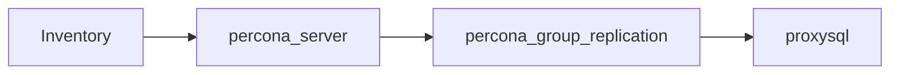

# Architecture

| Layer | Owner |
|---|---|
| Packages, identity, mysqld.cnf | percona_server |
| Group membership and recovery channel | percona_group_replication |
| Primary election | MySQL Group Replication itself |
| Application routing | ProxySQL native group monitor |
| Proxy endpoint | Single ProxySQL on port 6033; no failover. Point the app at proxy1, or put your own load balancer in front. |

## Placement

| Profile | VMs |
|---|---|
| Standalone | One database VM |
| HA example | Three database VMs + one proxy VM |
| Three-VM lab | The proxy may share a database VM; use the same inventory host name in both groups |

Place databases on different physical hosts. A three-member group can retain quorum after one member fails. Losing quorum stops writes; setup never force-bootstraps an old group.

A local HA group is not a remote DR site.

## Network

| Traffic | Port |
|---|---|
| App → proxies | TCP 6033 |
| Proxy → databases; member recovery | TCP 3306 |
| Group communication between databases | TCP 33061 |
| Proxy administration | TCP 6032, localhost |

## References

- [Percona Group Replication architecture](https://docs.percona.com/percona-distribution-for-mysql/8.4/deploy-pdps-group-replication.html)
- [ProxySQL native Group Replication monitor](https://proxysql.com/documentation/group-replication-configuration/)
- [8.4 removed options](https://dev.mysql.com/doc/refman/8.4/en/added-deprecated-removed.html)

The older guide's removed variables and legacy sys view are not copied into this setup.
