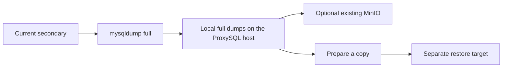

# Backups



The inventory schedules a full backup daily at 01:00 on the ProxySQL host's timezone. The backup runs on the ProxySQL host and dumps from a secondary (replica) over TCP, falling back to the primary only when no secondary answers; nothing is installed on the database nodes. Every backup is a standalone full dump; there is no incremental mode. Backups retain local staging even with MinIO.

```bash
# Run on the selected backup VM
sudo /usr/local/bin/percona-backup backup full
```

| Setting | Value |
|---|---|
| `backup_path` | `/var/backup/mysql` |
| `backup_schedule_enabled` | `true` in example inventory |
| `backup_storage` | `local` or `minio` |
| `backup_hour` / `backup_minute` | `1` / `0` |
| `backup_retention_days` | `7`; prune runs daily at 02:30 and always keeps the newest chain |
| `backup_binlog_archive_enabled` | `true`; rotated binlogs are shipped every 5 minutes |

## Retention

`sudo /usr/local/bin/percona-backup prune --retention-days 7` deletes complete
backups older than the retention window. The newest complete backup is always kept, so pruning can never remove the only
restorable backup. Archived binlogs older than the oldest kept backup are aged
out at the same time. A daily cron runs this automatically
(`backup_prune_enabled`).

```bash
# Inspect before you prune
sudo /usr/local/bin/percona-backup status
```

## Binlog archiving and point-in-time recovery

Every five minutes the ProxySQL host downloads rotated (finished) binary logs from the primary to
`backup_binlog_path` (`/var/backup/binlog`); with MinIO storage they are also
mirrored to `<bucket>/<host>-binlog`. The active log is skipped because the
server is still writing to it. This gives point-in-time recovery: restore a
full backup to an isolated VM, then replay the archived binlogs up to the
target moment. The exact steps are in `docs/operations.md`.

## Optional MinIO

Supply an existing bucket and client download details:

```yaml
backup_storage: minio
backup_minio_endpoint: https://minio.example.internal
backup_minio_bucket: percona-backup
backup_minio_access_key: '{{ vault_minio_access_key }}'
backup_minio_secret_key: '{{ vault_minio_secret_key }}'
backup_mc_url: '<mc download URL>'
backup_mc_checksum: 'sha256:<checksum>'
```

Run `playbooks/operations/backup.yml` with your selected inventory. This does not install a MinIO server.

## Explicit restore

Prepare a separate standalone 8.4 VM and list it under `restore_targets`, outside `database`. Copy the complete backup into its `backup_path` first; MinIO download is manual in this version. Install Percona 8.4 on the target before restore.

```bash
ansible-playbook -i inventories/group-two-proxies.yml playbooks/operations/restore.yml --ask-vault-pass   --limit restore1 -e backup_restore_target=restore1   -e backup_restore_id=<backup-id> -e backup_restore_workdir=/var/tmp/restore-run1
```

The mysqldump logical restore is not yet implemented: `playbooks/operations/restore.yml` refuses to run until it is. When it lands, restore will load `dump.sql` into a fresh datadir on an isolated target; it will not join the target to the group or promote it.

Retention pruning, binlog archiving and point-in-time replay are implemented (see above). Still not implemented: remote DR site, cross-region copies beyond MinIO mirroring. Monitor backup disk use; `status` shows the newest backup age at a glance.
