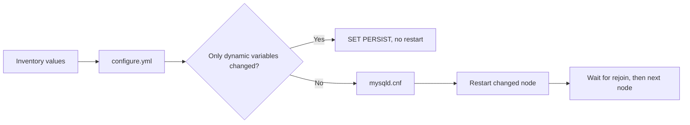

# Configuration



Dynamic variables, applied with no restart: max-connections
(percona_max_connections), long-query-time (percona_slow_query_time) and
binlog-expire-logs-seconds (percona_binlog_expire_logs_seconds). Every
other change uses the rolling restart path. Full detail, including the
warning about inventory defaults, is in
[day-2 configuration](day-2-configuration.md).

Edit [shared values](../inventories/group_vars/all/main.yml); use `host_vars/<host>.yml` for node-specific values.

| Variable | Default / purpose |
|---|---|
| `percona_max_connections` | `150` |
| `percona_buffer_pool_percent` | `50` percent of detected RAM |
| `percona_innodb_buffer_pool_size` | Computed; override with e.g. `2G` |
| `percona_slow_query_time` | `2` seconds |
| `percona_binlog_expire_logs_seconds` | `604800` (7 days) |
| `percona_server_id` | Unique per database host; do not change after setup |
| `percona_group_name` | One UUID shared by the group; do not change after setup |
| `percona_group_seed` | Initial bootstrap node only; not a permanent writer |
| `percona_group_password` | Recovery credential; use the same value on every member |
| `percona_databases` / `percona_users` | Managed by `operations/access.yml` on the discovered writer |
| `backup_schedule_enabled` | Example inventory enables daily full backups |
| `proxysql_ha_enabled` | `false` until VIP/interface are supplied |

```yaml
percona_max_connections: 300
percona_innodb_buffer_pool_size: 2G
```

```bash
ansible-playbook -i inventories/group-two-proxies.yml playbooks/operations/configure.yml --ask-vault-pass
```

Database and user changes use a separate command, without restarting MySQL:

```bash
ansible-playbook -i inventories/group-two-proxies.yml playbooks/operations/access.yml --ask-vault-pass
```

See [database and user examples](../roles/percona_access/README.md) for adding,
updating and removing entries. `configure.yml` only changes server settings.

## Sizing notes

`percona_buffer_pool_percent` defaults to 50% of detected RAM. That is a safe
default for shared or small VMs: on 8 GB it gives a 4 GB pool and leaves room
for connections, the OS, backups and the exporter. On a dedicated database
server, 70% is the usual production target; set it explicitly:

```yaml
percona_buffer_pool_percent: 70
```

Sizes snap to 1 GB steps above 1 GB and 128 MB steps below, with a 128 MB
floor, so the value always fits the server's chunk alignment.

`percona_max_connections` (150) is modest on purpose; raise it only if the
application really opens that many connections, because each one costs memory.
`sync-binlog = 1` and `innodb-flush-log-at-trx-commit = 1` are fixed for
durability and are not tunable here.

This workflow is not a live-only tuner or a major-version upgrade command.
Static config changes still restart nodes one at a time, so check
application reconnect behavior before using it on active traffic. Dynamic
variables are the only no-restart path, and they are listed above.

Root credentials must be consistent across the sample group. Recovery credentials are provisioned on offline members; online recovery-password rotation is deferred. Account changes use the currently elected writer rather than a fixed db1.
