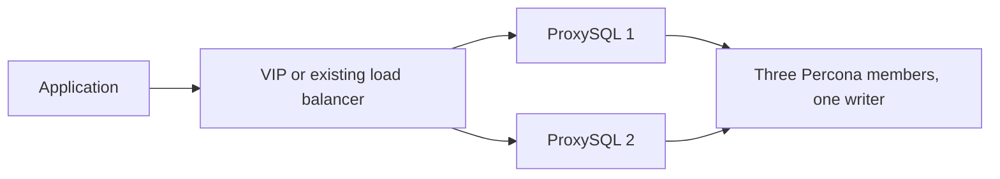

# Choose your deployment

One topology, one workflow. This branch ships the two-proxy setup only.
Run one command.

## Before you start

1. Install dependencies: `ansible-galaxy collection install -r requirements.yml`.
2. Replace the example VM addresses in your chosen inventory.
3. Credentials live in the encrypted `inventories/group_vars/all/vault.yml`; edit it with `ansible-vault edit inventories/group_vars/all/vault.yml`.
4. For a new group, set a unique `percona_group_name` UUID in the shared variables. Keep the UUID unchanged on reruns.
5. Run the preflight check first. It fails fast on the mistakes that waste the most time.

```bash
ansible-playbook -i inventories/group-two-proxies.yml playbooks/operations/preflight.yml --ask-vault-pass
```

## 1. Group Replication with two ProxySQL nodes



Inventory: `inventories/group-two-proxies.yml`. Three database VMs and two
proxy VMs. For one stable client endpoint, configure the VIP and interface
and enable `proxysql_ha_enabled` in `roles/proxysql_ha/defaults/main.yml`, or point your
existing load balancer at both proxies. Two proxies alone do not create a
stable endpoint.

```bash
ansible-playbook -i inventories/group-two-proxies.yml playbooks/group-two-proxies.yml --ask-vault-pass --ask-become-pass
```

Connect through the VIP or load balancer on port 6033. ProxySQL always
follows the elected group writer. If the writer fails, the group elects a new
one automatically; ProxySQL moves the traffic within seconds. This is local
high availability; cross-site disaster recovery is not included.

If deploy stops at the group join step, rerun the same deploy command.
A member that is already ONLINE is skipped on rerun, and the remaining
plays (proxy) then complete. Do not re-bootstrap a
group that already has ONLINE members.

## After deployment

Confirm the group is healthy. On any database VM, open `mysql -u root -p`:

```sql
SELECT MEMBER_HOST, MEMBER_STATE, MEMBER_ROLE
FROM performance_schema.replication_group_members;
```

Expect three ONLINE members and exactly one PRIMARY. Then connect through
the VIP or load balancer on port 6033 and run an application query.

Use the same inventory for every later command. Day-to-day operations live
under `playbooks/operations/`: `proxysql` (reapply proxy settings) and
`preflight` (re-run the safety checks).

Before calling any deployment production-ready, complete the [acceptance
walkthrough](production-checklist.md#acceptance-walkthrough-deployment-rerun-and-failover):
deployment, rerun and failover drill.
