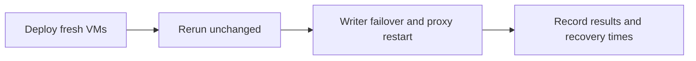

# Production checklist

Decisions to make with the client before the first production deploy. Each item
has a default in this repository; change the ones the client cares about and
record the answers next to the inventory.

## Topology and endpoint

| Decision | Default | Notes |
|---|---|---|
| Database nodes | 3, single-primary Group Replication | Minimum for quorum. Survives one node failure. |
| Proxy nodes | 1 | One ProxySQL node; no proxy failover. |
| Stable endpoint | proxy1 on port 6033, or the client's own load balancer in front of it | No proxy failover on this branch. |
| Read/write split | All traffic starts on the writer; read rules are opt-in (`proxysql_query_rules`) | Do not send every SELECT to secondaries unless the app tolerates slightly stale reads. |

## Data safety

This branch ships the highly available group only. Off-site copies and
point-in-time recovery are not part of this branch; arrange them separately
and record the RPO and RTO that design provides before calling any
deployment production-ready.

## Security

| Decision | Default | Notes |
|---|---|---|
| Secrets | ansible-vault `vault.yml` | Never commit plaintext. Rotate before handover. |
| MySQL TLS | Off (`percona_require_secure_transport: false`) | Turn on when the client's apps support it. |
| Group Replication TLS | Off (`percona_gr_ssl: false`) | Turn on before the first bootstrap if required; changing it later needs a rolling group restart. Must be identical on all members. |
| ProxySQL admin | Localhost only, vault password | Never expose 6032. |
| OS access | `ubuntu` + SSH keys + sudo | Decide who holds the keys. |

## Sizing

| Item | Rule |
|---|---|
| RAM | 8 GB minimum per database node. The buffer pool auto-sizes to 50% of RAM. |
| Disk | datadir + 7 days of binlogs + 20% headroom. Binlogs alone can surprise you on write-heavy workloads. |
| CPU | 2 vCPU is a lab floor, not a production recommendation. Size from the client's workload. |

## Acceptance walkthrough: deployment, rerun and failover

Run this on dedicated staging VMs before the client production rollout. The failover steps deliberately stop services. Use your own inventory and addresses below; commands assume a repository checkout.



### 1. Deploy and establish a baseline

Fill the inventory and Vault credentials first. Use three database VMs and one proxy.

```bash
# Controller
ansible-playbook -i inventories/group-one-proxy.yml playbooks/operations/preflight.yml --ask-vault-pass
ansible-playbook -i inventories/group-one-proxy.yml playbooks/group-one-proxy.yml --ask-vault-pass
```

On any database VM, open `mysql -u root -p`:

```sql
SELECT VERSION(), @@server_uuid;
SELECT MEMBER_HOST, MEMBER_STATE, MEMBER_ROLE
FROM performance_schema.replication_group_members;
```

**Pass:** Percona 8.4, three ONLINE members and exactly one PRIMARY. Record which host is the current writer; do not assume db1.

On the current writer, create a small test table using the root SQL session:

```sql
CREATE TABLE appdb.acceptance_probe (id INT PRIMARY KEY, note VARCHAR(100));
```

From the application/client machine, connect through the actual client endpoint:

```bash
mysql -h <proxy-ip> -P 6033 -u appuser -p appdb
```

```sql
INSERT INTO acceptance_probe VALUES (1, 'before failover');
SELECT * FROM acceptance_probe;
```

**Pass:** the proxy accepts application queries, row 1 is visible through the proxy, and the member list shows three ONLINE members with exactly one PRIMARY.

### 2. Rerun without changing inventory

On each database VM, record the service start time:

```bash
systemctl show mysql -p ActiveEnterTimestamp
```

Rerun the same deployment from the controller:

```bash
ansible-playbook -i inventories/group-one-proxy.yml playbooks/group-one-proxy.yml --ask-vault-pass
```

Then confirm the member list again:

```sql
SELECT MEMBER_HOST, MEMBER_STATE, MEMBER_ROLE
FROM performance_schema.replication_group_members;
```

**Pass:** all members remain healthy, server UUIDs and row 1 remain unchanged, and MySQL service start times have not changed. Package/cache or scheduling tasks may report changes; inspect the reasons rather than requiring the entire recap to say `changed=0`.

### 3. Test writer failover

Keep two healthy database members running throughout this drill. Record the time, then run **only on the current writer**:

```bash
sudo systemctl stop mysql
```

On a surviving database VM:

```bash
mysql -u root -p -e "SELECT MEMBER_HOST, MEMBER_STATE, MEMBER_ROLE FROM performance_schema.replication_group_members;"
```

On the proxy, inspect routing:

```bash
mysql -h 127.0.0.1 -P 6032 -u admin -p -e "SELECT hostgroup_id, hostname, status FROM runtime_mysql_servers;"
```

Reconnect through the **same application endpoint**, then run:

```sql
INSERT INTO appdb.acceptance_probe VALUES (2, 'after writer failover');
SELECT * FROM appdb.acceptance_probe ORDER BY id;
```

**Pass:** a surviving node becomes PRIMARY, hostgroup 10 has one ONLINE writer matching it, row 1 remains and row 2 can be committed. Record time from service stop to the first successful application write. Existing connections may need reconnecting; verify the real application's retry behavior too.

On the stopped VM:

```bash
sudo systemctl start mysql
```

Wait for all three members to be ONLINE and confirm with the member list query. Do not run the full verification while its first database host is stopped. A service-stop drill does not prove network-partition or sudden-power-loss behavior; record those as separate untested scenarios unless exercised.

### 4. Test the proxy endpoint

Stop ProxySQL on proxy1:

```bash
sudo systemctl stop proxysql
```

Confirm the application endpoint is down while ProxySQL is stopped: with one proxy there is no failover, and the app cannot connect. Then restore the service:

```bash
sudo systemctl start proxysql
```

**Pass:** the endpoint works again after the restart. With a single proxy and no client failover, mark endpoint HA as **not provided**.

### Record the result

| Test | Result: PASS / FAIL / NOT RUN | Evidence |
|---|---|---|
| Fresh deployment | | Version, member list, application query |
| Unchanged rerun | | Recap, UUIDs, service start times |
| Writer failover and rejoin | | Old/new primary, first successful write, duration |
| Proxy endpoint restart | | Endpoint, duration |

Save results with the inventory revision, collection version and date. Agree acceptable outage and data-loss limits with the client and compare the measured results. A skipped or failed test is not a pass. Remove the test table from the live writer after completing the drill.
