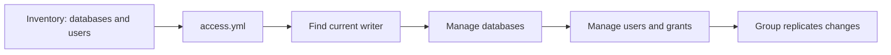

# percona_access

Creates, updates or removes explicitly listed application databases and users.
Runs on the current writer; Group Replication copies changes to the other nodes.
No package installation or MySQL restart.

The shared `tasks/discover.yml` finds the current writer. Backup, exporter and
ProxySQL roles reuse only this task file for their own account setup.



Two user lists exist, choose one per account, never both:

- App connects through ProxySQL (normal case): use `proxysql_users` in
  `inventories/group_vars/proxies.yml` and run `proxysql.yml`. That role
  creates both the MySQL account and the ProxySQL credential.
- Account connects directly to MySQL, not through ProxySQL (reporting,
  admin, direct client): use `percona_users` below and run `access.yml`.
  That role creates only the MySQL account, no ProxySQL credential.

Normal application users: if you want cluster benefits, use
`proxysql_users` and `proxysql.yml`. Cluster benefits means one ProxySQL
endpoint on port 6033, automatic writer failover when the PRIMARY changes,
and connection pooling through multiplexing. A user created only with
`access.yml` (`percona_users`) gets none of these benefits: it works only
by direct connection to one MySQL node, and ProxySQL will deny it with an
access denied error, even with the correct password, because ProxySQL does
not know that user.

Edit `inventories/group_vars/all/main.yml`; keep passwords in encrypted `vault.yml`:

```yaml
percona_databases:
- name: appdb

percona_users:
- name: report_reader
  host: '192.0.2.50' # Client address as seen by MySQL
  password: '{{ vault_report_reader_password }}'
  priv: 'appdb.*:SELECT'
```

Then run with your chosen inventory:

```bash
ansible-playbook -i inventories/group-one-proxy.yml playbooks/operations/access.yml --ask-vault-pass
```

Both deployment playbooks already run this role after the group forms.
For later changes, rerun only `access.yml`.

| Change | What to edit |
|---|---|
| Add a database/user | Add a list entry; `state: present` is the default |
| Change password or grants | Update the user's password or complete `priv` value |
| Remove a user | Keep its name and host, set `state: absent`; no password or grants needed |
| Remove a database and its data | Set `state: absent` and `percona_allow_database_drop: true` |
| Leave an existing object alone | Omit it from the list |

Database deletion is irreversible; take a backup first and reset the drop
flag after use. Removing a database does not remove users or their grants.

```yaml
percona_users:
- name: old_user
  host: '192.0.2.50'
  state: absent
```

`priv` replaces the managed account's grants, so list every privilege it should
retain. The default host is `%` (any host). Tables and schema migrations are
managed separately.

Backup, exporter, recovery and ProxySQL accounts stay in their existing roles.
For accounts connecting through ProxySQL, use `proxysql_users` and
`playbooks/operations/proxysql.yml`; do not manage the same account in both lists.

[Defaults](defaults/main.yml) · [Project setup](../../README.md)
